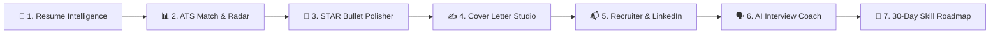

# 🚀 CareerAI Pro | AI Resume & Career Intelligence Suite

[](https://www.python.org/)
[](https://streamlit.io/)
[](https://aistudio.google.com/)
[-success.svg)]()

**CareerAI Pro** is an enterprise-grade AI career acceleration and job search platform. Built with Python, Streamlit, and Google Gemini, it empowers job seekers with end-to-end intelligence: from deep resume parsing and ATS benchmarking to STAR bullet optimization, tailored cover letters, recruiter cold outreach, interactive mock interview coaching, and personalized 30-day upskilling roadmaps. It features full **Smart Offline Heuristic Degradation** allowing all 7 steps to run seamlessly even without an API key.

---

## 🌟 Key Capabilities & 7-Step Career Flow



### 1. 📄 Structured Resume Intelligence
- Multi-format ingestion: **PDF (stream-safe)**, **DOCX (with table layout & header preservation)**, **TXT**, **Markdown**, or **Direct Text Paste**.
- Offline extraction of contact data (email, phone, city/state location, LinkedIn, GitHub, portfolio) and prioritized explicit experience years estimation.
- 6-domain semantic skill categorization across 220+ technical and soft competencies.

### 2. 📊 Multi-Dimensional ATS Benchmarking & Radar Audit
- Interactive 5-dimensional Radar/Spider chart (`Skills Alignment`, `Experience Depth`, `Quantified Impact`, `ATS Formatting`, `Education & Certs`).
- Dual-sided keyword gap analysis: detects exactly which keywords from the job description are matched vs missing.
- Section-by-section ATS health checklist (`Contact`, `Summary`, `Experience`, `Skills`, `Education`).
- **1-Click Export** as formatted Markdown (`.md`) or styled Microsoft Word document (`.docx`).

### 3. 🚀 AI Resume Optimizer (Google XYZ Bullet Polisher)
- Upgrades passive bullets using Google's formula: *"Accomplished [X], as measured by [Y], by doing [Z]"*.
- Generates 3 distinct variations per bullet: **Metric-Driven**, **Leadership & Ownership**, and **Technical Stack Rigor**.
- One-click Tailored Executive Summary generator tuned specifically to target roles.
- Runs via Google Gemini or Smart Offline Heuristics with automated fallback.

### 4. ✍️ AI Cover Letter Studio
- Customization by tone (*Professional, Executive, Enthusiastic, Technical*), length (*250, 350, or 450 words*), hiring manager, and special project focus.
- Live in-app draft editor.
- **Export directly to `.docx` and `.txt`**.

### 5. 📬 Recruiter Outreach & LinkedIn Personal Branding
- **Cold Networking Kit**:
  - LinkedIn Connection Request Note (strictly `<300` characters for 100% sendability).
  - Recruiter InMail Message.
  - Peer/Alumni Employee Referral Request Note.
  - Direct Hiring Manager Cold Email Pitch with subject line & 3 impact bullets.
- **LinkedIn Profile Optimizer**:
  - 3 high-converting profile headlines.
  - 1st-person 3-paragraph "About" summary.
  - Top 5 recommended skills to pin.
  - **1-Click Export as `.docx` and `.txt`**.

### 6. 🗣️ AI Mock Interview Coach 2.0 (STAR Evaluator & Follow-ups)
- Calibrated by seniority level (*Junior, Mid-Level, Senior, Staff/Lead*).
- 5 tailored scenarios (Technical Architecture, Behavioral STAR, Situational).
- Rigorous STAR rubric evaluation scoring *Situation*, *Task*, *Action*, and *Result* out of 10, plus constructive growth areas and an exemplary model response.
- **Dynamic Interviewer Follow-Up Question Generator** simulating a live conversation drill-down.
- **Strategic Interview Cheat Sheet**: top 3 anchor stories from candidate's resume, 3 curveball questions to watch out for, and 4 smart questions to ask the interviewer.
- **Export Mock Interview Scorecard to `.docx`**.

### 7. 🎯 30-Day Skill Gap & Portfolio Roadmap
- Automatically takes detected skill gaps from the ATS audit and generates a custom 4-week fast-track learning curriculum.
- 2 industry-grade portfolio project blueprints with recommended tech stacks and preview resume bullets.
- **1-Click Export as `.docx` and `.md`**.

---

## 🛠️ Architecture & Tech Stack

- **Frontend & App Engine**: [Streamlit](https://streamlit.io/) with responsive CSS & high-contrast dark mode support.
- **Language Models**: [Google Gemini](https://aistudio.google.com/) (`gemini-2.0-flash`, `gemini-2.0-flash-lite`, `gemini-1.5-flash`, `gemini-1.5-pro`) with automatic fallback cascades and smart offline mode.
- **Natural Language & Text Processing**: `scikit-learn` (TF-IDF Vectorizer), `PyPDF2`, `python-docx`, regex tokenizers.
- **Data Visualization**: [Plotly](https://plotly.com/) polar/radar charts.
- **Document Generation**: `python-docx` for `.docx` and pure Markdown exporters.

---

## 🚀 Quickstart & Setup

### 1. Clone & Set Up Virtual Environment
```bash
git clone <repository-url>
cd AI_Resume

# Create virtual environment
python -m venv venv

# Activate on Windows:
.\venv\Scripts\activate

# Or on macOS/Linux:
source venv/bin/activate
```

### 2. Install Dependencies
```bash
pip install -r requirements.txt
```

### 3. Configure Gemini API Key (Optional but Recommended)
Get a free API key at [Google AI Studio](https://aistudio.google.com/).

You can provide it in any of three convenient ways:
1. Copy `.env.example` to `.env` and enter your key:
   ```env
   GEMINI_API_KEY=AIzaSy...
   ```
2. Set environment variable: `set GEMINI_API_KEY="your-key"`
3. Or enter it directly in the **app sidebar password box**.

*(Note: If no API key is provided, the application runs smoothly in **Smart Offline Heuristic Mode** with TF-IDF scoring, rule-based skill extraction, and document exports.)*

### 4. Run the Streamlit Application
```bash
streamlit run app.py
```

### 5. Run the Automated Test Suite
```bash
python -m unittest tests/test_all_features.py
```

---

## 📁 Project Structure

```
AI_Resume/
│
├── app.py                         # Main Streamlit application & 7-step career UI
├── requirements.txt               # Project dependencies
├── .env.example                   # Environment variable template
├── README.md                      # Comprehensive documentation
│
├── data/
│   └── skills.csv                 # 220+ in-demand skills taxonomy dataset
│
├── utils/
│   ├── ats_score.py               # TF-IDF & dual-sided ATS scoring heuristics
│   ├── custom_css.py              # Modern CSS, badges & dark-mode styling
│   ├── export_helper.py           # Word (.docx) & Markdown export generators
│   ├── gemini_service.py          # Resilient multi-model Gemini LLM service
│   ├── information_extractor.py   # Regex & heuristic contact/experience extractor
│   ├── resume_parser.py           # Robust PDF, DOCX (tables) & TXT parser
│   └── skill_extractor.py         # Categorized skills engine with alias resolution
│
└── tests/
    └── test_all_features.py       # Automated unit test suite (11 test cases)
```

---

## 🛡️ License
MIT License. Built for job seekers, developers, and career builders worldwide.
